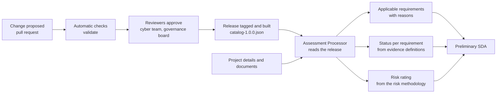

# CRISP sample catalog

A small, made-up example of the **Knowledge Catalog** for CRISP, and of how an **Assessment Processor** reads and applies it.

> **Illustrative only.** The NIST control IDs (SP 800-53 Rev 5) are real. Everything else is made up: requirement wording, decisions, rules, risk method, thresholds, patterns, targets, owners, dates and approvals. Cyber leadership confirms the NIST publication and revision before anything here is used for real.

## What this shows

CRISP needs one approved, versioned set of knowledge that every project is assessed against. This repository keeps that knowledge as plain text files, so it can be reviewed, approved, versioned and read by software.

- **People** write and approve the content through pull requests.
- **The Assessment Processor** reads a frozen release of it and applies it to a project.
- **An AI agent** helps with reading and drafting, but never applies the rules or makes decisions.

## How it works



1. **Write.** Requirements, rules, patterns, targets, the threat library and the risk methodology are YAML files in this repository.
2. **Review.** Every change is a pull request. Automatic checks catch mistakes (missing owner, broken link, bad threshold). The cyber team, and where required the governance board, approve.
3. **Release.** An approved set becomes a version, for example `1.0.0`. The build step turns the files into one JSON file, `dist/catalog-1.0.0.json`. A release never changes.
4. **Pin.** A project is linked to the catalog version it started with. A new release does not change a project already in assessment. Moving it needs the security architect's request and the cyber team's agreement, with the reason recorded.
5. **Assess.** The Assessment Processor reads the pinned release only (not the live files) and applies it to the project.

## What the Assessment Processor does with the catalog

| Step | What happens | Done by |
|---|---|---|
| Classify | Project details are matched against the classification rules to give a category (tier 1, 2 or 3) | Code |
| Applicability | Applicability rules return the requirements that apply, each with a reason and rule version | Code |
| Threat factor | Threats found in the project's threat model add the requirements linked to them in the threat library, with the threat as the reason | Code |
| Status | Each requirement's evidence definition says what counts as *addressed* or *partly addressed*. The status follows the evidence | Code, confirmed by a person |
| Risk | The risk methodology turns project details into an inherent score, and the status into a residual score and rating | Code |
| Target | The project's category picks the target it must reach | Code |
| Review and sign-off | Overrides, risk acceptance and sign-off | People |

## Where an AI agent fits

An AI agent works **on top of** the processor and uses it as a tool. It is for jobs that involve reading and writing:

- reads design documents and suggests project details for the architect to confirm
- drafts the threat model using the method, threat library and templates in the catalog
- proposes where evidence for a requirement can be found
- explains gaps and drafts suggested actions and summaries
- (in the catalog) drafts requirement wording, finds duplicates and suggests requirement-to-threat links, all as pull requests that people review

It does **not** apply rules, set requirement status, calculate risk, approve overrides or sign off. Those come from the rules, the evidence definitions, the risk methodology and people. This keeps results repeatable, explainable (for example "rule APP-004 version 1") and tied to the pinned version. The threat model completeness check is also code, so nothing is silently missed.

## Try it

Needs Python 3 and PyYAML (`pip install pyyaml`).

```
python3 tools/crisp_catalog.py validate   # checks links, owners, evidence, thresholds
python3 tools/crisp_catalog.py build      # writes dist/catalog-1.0.0.json
python3 tools/crisp_catalog.py assess     # applies the pinned release to the sample project
```

`sample-output.txt` shows the result for the made-up "Payments portal": tier 1, a threat model required, inherent risk 9 (High), and a list of 17 applicable requirements, each with its status, residual risk and the reason it applies. For example, the threat "stolen session token" adds the session protection requirement.

## Folder map

| Path | What it holds |
|---|---|
| `catalog.yaml` | Manifest: version, framework basis, list of files |
| `vocabulary.yaml` | Shared terms |
| `framework/adoption.yaml` | Adopt, tailor or exclude decisions with reason and date |
| `requirements/` | 17 requirements: statement, owner, source, NIST reference, evidence definition |
| `rules/project-attributes.yaml` | Project details the rules use, allowed values and where each comes from |
| `rules/classification-rules.yaml` | Puts a project in tier 1, 2 or 3 |
| `rules/applicability-rules.yaml` | 9 rules: which requirements apply and why |
| `rules/override-reasons.yaml` | Standard reasons for adding, excluding or overriding a requirement |
| `patterns-targets/` | 2 patterns and the targets per tier, with how each is measured |
| `threat-modeling/` | Methods, trigger and selection rules, threat library with requirement links, completeness checklist |
| `risk/risk-methodology.yaml` | Factors, scales, thresholds, inherent and residual risk, overrides, worked examples |
| `process/` | Versioning, approvals, release steps and example change records |
| `project/sample-project.yaml` | A made-up project to try the catalog on |
| `tools/crisp_catalog.py` | The `validate`, `build` and `assess` commands |
| `dist/` | The built release bundle that the assessor reads |
| `sample-output.txt` | Output of `assess` on the sample project |

## Design choices

- **Write in YAML, ship as JSON.** YAML is easier for people to review. JSON is what software reads.
- **Rules are data, not code.** A rule says "if these project details, then require these requirements, because this reason". Anyone can review it.
- **Risk methodology: data here, calculation in code.** Factors, scales and thresholds are files. The calculation is code, versioned with the same release so the two always match.
- **Only knowledge lives here.** Projects, assessments, evidence, results, decisions and the audit trail belong in a database, not in this repository.
- **Read a released copy, not the live files.** It is faster, still works if the repository is unavailable, and cannot be changed by accident.
